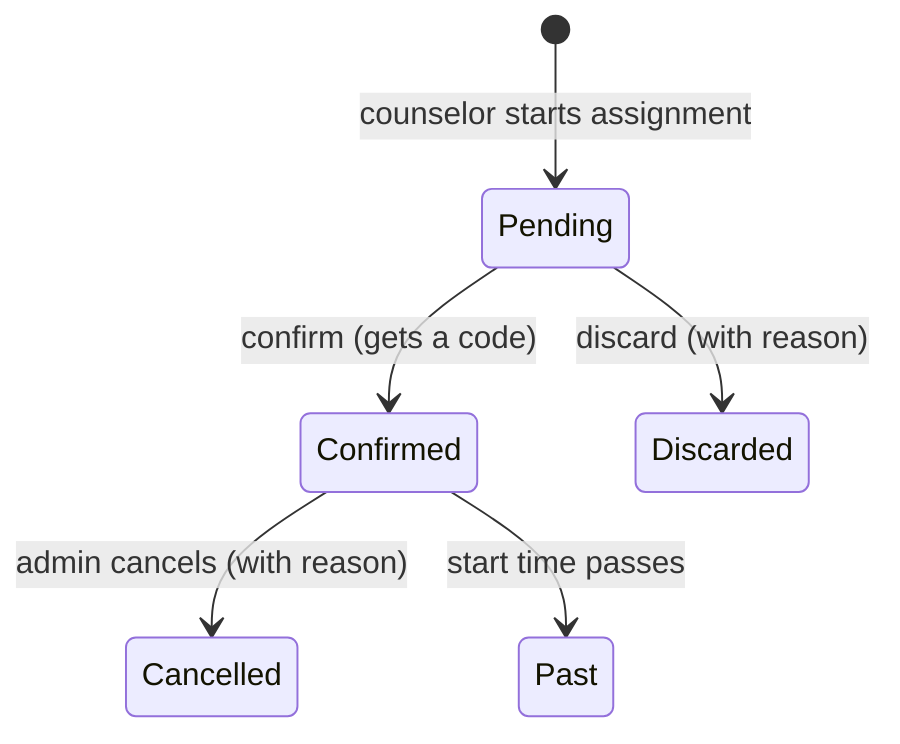

# Appointment Matchmaker

A web app for matching appointments with specialists. It has two parts:

- `backend/`: a FastAPI API (see [backend/README.md](backend/README.md))
- `frontend/`: a React/TanStack app (see [frontend/README.md](frontend/README.md))

The API contract is in [openapi.yaml](openapi.yaml).

## How the application works

Counselors at a support line use the app to book follow-up appointments with
specialists. They find an open time slot, hold it for a person, and confirm it to
get an appointment code. Administrators manage the specialists, their availability
and the user accounts. Specialists see their own schedule. The full functional
scope is in [docs/spec.md](docs/spec.md) (Spanish version:
[docs/spec_spa.md](docs/spec_spa.md)).

The interface is in Spanish. All dates and times are shown in Colombia time (UTC−5).

### Roles

Each user has one of three roles. After logging in, users land on a menu that
shows only what their role can do.

| Role | Can do | Pages |
|---|---|---|
| **Admin** (`admin`) | Everything a counselor can, plus: manage users, specialists, departments and areas, and availability; set the appointment length and the yearly code letters; confirm or discard any pending assignment; cancel confirmed appointments; review correction requests | Search availability, Assignments and appointments, Availability, Specialists, Departments and areas, Users, Settings |
| **Counselor** (`orientador`) | Search availability, start assignments, confirm or discard the ones they started, see all confirmed appointments, ask an admin to correct a confirmed appointment | Search availability, Assignments and appointments |
| **Specialist** (`especialista`) | See their own confirmed appointments: today, upcoming and past. Read only | My schedule |

### Main concepts

- **Specialist**: a professional who takes appointments. Each one has a code and
  belongs to one or more **departments** and **areas of intervention**.
- **Slot**: a time when a specialist is available, loaded by an admin. Every slot
  lasts the configured appointment length. Admins can deactivate a slot.
- **Assignment**: a booking of one slot for one person, recorded with the person's
  name and/or mobile number. The reason for the call is never stored.

### The booking flow

1. **Search.** A counselor searches for open slots by specialist, department or
   area, either for the coming days or for a specific date. Only active, future
   slots of active specialists that are not already taken are shown.
2. **Start an assignment.** The counselor picks a slot, enters the person's name
   and/or mobile number, reviews the details, and saves. The assignment is now
   **pending** and the slot is held, so nobody else can book it.
3. **Confirm or discard.** The counselor who started it, or an admin, then either:
   - **confirms** it. It becomes a **confirmed** appointment and gets a unique code
     such as `AB00042`: the two letters the admin set for the current year,
     followed by a running number.
   - **discards** it, giving a reason. The slot becomes free again.
4. **After confirmation.** Counselors can't change a confirmed appointment. They can
   send a **correction request** to the admins. Only an admin can **cancel** a
   confirmed appointment (giving a reason, and only before it starts), which frees
   the slot. An admin can start a new assignment from a cancelled one with the
   person's details filled in.



Discarded and cancelled assignments are kept, with who closed them, when and why,
as an operational history. On the assignments page, counselors see the
assignments they started (newest first) and all confirmed appointments. Admins see
everything and can filter by specialist and status.

### Accounts and sign-in

- Users log in with a username and password. Admins create accounts, choose the
  role and set the initial password. A deactivated account can't log in, but its
  past actions still show who did them.
- After 3 failed login attempts, the account is locked for 5 minutes.
- Users who forget their password can request a reset from the login page.
  No email is sent yet: for now the reset link appears on screen.

### Architecture

```
Browser ──► FastAPI (one container, port 8000)
              ├── /api/*   REST API (openapi.yaml), bearer-token auth
              ├── /docs    interactive API docs
              └── /*       built frontend (single-page app)
                     │
                     ▼
               SQLAlchemy ──► SQLite (default) or another database
```

- **Frontend**: React with TanStack Router and Query, Tailwind and shadcn/ui. All
  API calls go through one services layer (`frontend/src/services/`). A built-in
  in-memory mock lets the frontend run without the backend (`VITE_USE_MOCK=true`).
- **Backend**: FastAPI. Data is stored with SQLAlchemy, passwords are hashed with
  bcrypt, and login sessions are kept in the database. Tables are created on
  startup, and demo data is loaded into an empty database unless
  `SEED_DEMO_DATA=false`.
- **In Docker**: the frontend is built into static files, and the backend serves
  them along with the API. Any page URL (for example `/agenda`) returns the app,
  which then shows the right screen.

## Running with Docker

The `Dockerfile` builds the frontend with Node, then builds a Python image that runs
the backend. The backend also serves the frontend, so a single container runs the
whole app on one port.

You need [Docker](https://docs.docker.com/get-docker/) installed.

### Build the image

From the repository root:

```sh
docker build -t appointment-matchmaker .
```

Or use the Makefile shortcut:

```sh
make docker-build
```

### Run the container

```sh
docker run -d --name appointment-matchmaker \
  -p 8000:8000 \
  -v appointments-data:/data \
  appointment-matchmaker
```

Then open:

- App: http://localhost:8000
- API docs: http://localhost:8000/docs

The `-v appointments-data:/data` flag stores the SQLite database in a Docker volume,
so your data survives when the container is stopped or rebuilt. To use another port
on your machine, change the left side of `-p` (for example `-p 8080:8000`).

The Makefile shortcut runs it in the foreground (Ctrl+C stops it):

```sh
make docker-run              # http://localhost:8000
make docker-run PORT=8080    # http://localhost:8080
```

### Stop, view logs, restart

```sh
docker logs -f appointment-matchmaker   # follow the logs
docker stop appointment-matchmaker      # stop
docker start appointment-matchmaker     # start again
docker rm -f appointment-matchmaker     # remove the container (the data volume is kept)
```

After changing code, rebuild the image, then remove the old container and run it again:

```sh
docker build -t appointment-matchmaker .
docker rm -f appointment-matchmaker
docker run -d --name appointment-matchmaker -p 8000:8000 -v appointments-data:/data appointment-matchmaker
```

To start over with an empty database, delete the volume: `docker volume rm appointments-data`.

### Demo users

On first start, an empty database is filled with demo data, including these users:

| Username | Password | Role |
|---|---|---|
| `admin` | `admin123` | admin |
| `orientador` | `orientador123` | orientador |
| `especialista` | `especialista123` | especialista |

These passwords are public. For a real deployment, turn the demo data off.

### Configuration

Pass environment variables with `-e`:

| Variable | Default in the image | Meaning |
|---|---|---|
| `DATABASE_URL` | `sqlite:////data/appointments.db` | SQLAlchemy database URL (SQLite works as is; other databases need their driver added to the backend) |
| `SEED_DEMO_DATA` | `true` | Load the demo data into an empty database on startup |

Example:

```sh
docker run -d --name appointment-matchmaker -p 8000:8000 -v appointments-data:/data \
  -e SEED_DEMO_DATA=false \
  appointment-matchmaker
```

## Local development (without Docker)

```sh
make install   # install backend (uv) and frontend (npm) dependencies
make dev       # backend on :8000 and frontend dev server together
make test      # run all tests
```

Run `make help` to list every target.
